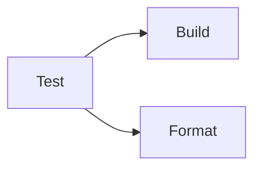

# CI pipeline

This page describes every GitHub Actions workflow in `.github/workflows/`, what each job checks, and the exact command that reproduces it on your machine. Read it when a check fails on your pull request and you want to know why, or before you push so that nothing fails at all.

## Prerequisites

To reproduce every check locally you need:

- **Rust stable** with the `rustfmt` and `clippy` components and the `wasm32v1-none` target:

  ```bash
  rustup update stable
  rustup component add rustfmt clippy
  rustup target add wasm32v1-none
  ```

- **Python 3 and pre-commit**, for the pre-commit checks: `pip install pre-commit` (or run `scripts/setup-hooks.sh`, which also installs the Git hook).
- **GNU make**, for the `make` shortcuts. Every `make` target below also has a plain `cargo` equivalent.

> **Warning:** CI installs whatever `stable` is on the day it runs (`dtolnay/rust-toolchain@stable`), and the repository has no `rust-toolchain.toml`. A new stable release can add a clippy lint that fails CI even though nothing in your branch changed. Run `rustup update stable` before you reproduce a clippy failure, or you may not see it locally.

## Workflows at a glance

| Workflow | File | Runs on | Blocks a broken change? |
| --- | --- | --- | --- |
| CI | `ci.yml` | Push and pull request to `main` or `contrib` | Yes: tests, formatting, clippy, WASM build |
| Pre-commit Checks | `pre-commit.yml` | Push and pull request to `main` or `contrib` | Yes: YAML, large files, merge markers, private keys, clippy, `cargo check` |
| Guard PR Base Branch | `guard-pr-base-branch.yml` | Pull request opened, reopened, edited or marked ready | Closes a non-admin PR that does not target `contrib` |
| Close Linked Issues on Contrib Merge | `close-linked-issues.yml` | Pull request merged into `contrib` | No, it only closes issues |
| Docs Quality | `docs-quality.yml` | Nothing: the trigger is commented out | No |
| Docs Site | `docs.yml` | Nothing: the trigger is commented out | No |

`CI` and `Pre-commit Checks` both ignore changes under `example/` (`paths-ignore: "example/**"`). A pull request that only touches `example/` runs neither of them. `example/` is a separate workspace that CI never builds or tests; see [ADR 0007](../architecture/decisions/0007-core-gateway-scope.md).

## Reproduce all of CI in one go

Run this from the repository root. It runs the same commands, in the same order, as the `CI` workflow and then the `Pre-commit Checks` workflow:

```bash
make fixtures
cargo test --workspace --all-features
cargo fmt --all -- --check
cargo clippy --workspace --all-features -- -D warnings
cargo build --workspace --target wasm32v1-none --release
pre-commit run --all-files
```

If all six commands succeed, every check that CI runs on your pull request passes too, as long as your toolchain matches (see the warning above).

## CI workflow (`ci.yml`)

**Triggers:** `push` and `pull_request` on the `main` and `contrib` branches, except when only `example/**` changed.

**Environment:** `CARGO_TERM_COLOR=always` and `RUST_BACKTRACE=1` for every job, so a panicking test prints its backtrace in the log.

**Job graph:**



`Build` and `Format` both declare `needs: test`. They start only after `Test` succeeds, and when `Test` fails they show as **skipped**, not failed. Fix the `Test` job first; the other two run once it passes.

### Caching

Every job restores the same cache with `actions/cache@v4`:

- **Paths:** `~/.cargo/bin/`, `~/.cargo/registry/index/`, `~/.cargo/registry/cache/`, `~/.cargo/git/db/` and `target/`.
- **Key:** `<runner OS>-cargo-<hash of every Cargo.lock>`.
- **Fallback:** `restore-keys: <runner OS>-cargo-`, so when `Cargo.lock` changes the job restores the most recent cache for the OS and rebuilds only what changed.

Because all three jobs share one key, the first job to finish on a new `Cargo.lock` saves the cache and the others reuse it. GitHub does not overwrite an existing cache key, so a cache is only refreshed when `Cargo.lock` changes.

### Test job

| Step | Command | Local reproduction |
| --- | --- | --- |
| Install Rust | `dtolnay/rust-toolchain@stable` with `rustfmt`, `clippy` and target `wasm32v1-none` | `rustup update stable` (see [Prerequisites](#prerequisites)) |
| Rebuild account fixture | `make fixtures` | `make fixtures` |
| Run tests | `cargo test --workspace --all-features` | `make test` |
| Check formatting | `cargo fmt --all -- --check` | `cargo fmt --all -- --check` |
| Run clippy | `cargo clippy --workspace --all-features -- -D warnings` | `make lint` |

`make fixtures` builds the `account` contract for `wasm32v1-none` and copies the result over `contracts/shade/src/tests/fixtures/account.wasm`. Shade's tests deploy that file as the real merchant account contract, so CI always tests against an account contract built from the same commit. Locally, the tests use whatever `account.wasm` is in your working tree, so run `make fixtures` first whenever you change anything under `contracts/account/`.

### Build job

| Step | Command | Local reproduction |
| --- | --- | --- |
| Install Rust | `dtolnay/rust-toolchain@stable` with target `wasm32v1-none` | `rustup target add wasm32v1-none` |
| Build contracts | `cargo build --workspace --target wasm32v1-none --release` | `make build` |
| Report contract sizes | `ls -l target/wasm32v1-none/release/*.wasm` | `make build` prints the sizes too |

The size report is informational: the job passes whatever size the contracts are. See [Known gaps](#known-gaps).

### Format job

| Step | Command | Local reproduction |
| --- | --- | --- |
| Install Rust | `dtolnay/rust-toolchain@stable` | `rustup update stable` |
| Format check | `cargo fmt --all -- --check` | `cargo fmt --all -- --check` |

This repeats the formatting step of the `Test` job. Because it needs `Test`, it never reports a formatting problem that `Test` did not already fail on.

## Pre-commit Checks workflow (`pre-commit.yml`)

**Triggers:** the same as `CI`: `push` and `pull_request` on `main` and `contrib`, except when only `example/**` changed.

**Job:** one job, `Pre-commit Hooks`. It installs Python 3 and `pre-commit`, then runs every hook in `.pre-commit-config.yaml` against every file in the repository (not only the changed ones). It has no cache and does not install a Rust toolchain itself: the Rust hooks use the Rust that comes preinstalled on the `ubuntu-latest` runner, which can be a different version from the one the `CI` workflow installs.

**Local reproduction:**

```bash
pre-commit run --all-files
```

To run a single hook, pass its ID, for example `pre-commit run clippy --all-files`.

Every hook skips files under `example/` (`exclude: ^example/`). The hooks are:

| Hook | What it checks | Local reproduction |
| --- | --- | --- |
| `check-yaml` | Every YAML file parses | `pre-commit run check-yaml --all-files` |
| `check-added-large-files` | No added file is larger than 1000 KB | `pre-commit run check-added-large-files --all-files` |
| `check-merge-conflict` | No leftover `<<<<<<<` / `>>>>>>>` conflict markers | `pre-commit run check-merge-conflict --all-files` |
| `check-case-conflict` | No two paths differ only by letter case | `pre-commit run check-case-conflict --all-files` |
| `mixed-line-ending` | Every file uses LF line endings; it rewrites CRLF files and fails | `pre-commit run mixed-line-ending --all-files` |
| `detect-private-key` | No private key is committed | `pre-commit run detect-private-key --all-files` |
| `clippy` | `cargo clippy --all-features -- -D warnings` at the workspace root | `make lint` |
| `cargo-check` | `cargo check --all-features` at the workspace root | `cargo check --workspace --all-features` |
| `prettier` | Runs `prettier --write --ignore-unknown` on TOML files | `pre-commit run prettier --all-files` |

> **Note:** The pre-commit configuration has no `cargo fmt` hook. Formatting is checked only by the `CI` workflow, so run `make fmt` before you commit.

> **Note:** Prettier has no built-in TOML parser and `--ignore-unknown` makes it skip files it cannot parse, so the `prettier` hook currently changes nothing. See [Known gaps](#known-gaps).

To run the hooks on every `git commit` instead of waiting for CI, install them once:

```bash
scripts/setup-hooks.sh
```

## Pull request housekeeping workflows

These two workflows do not check your code. They run with `pull_request_target`, so they use the workflow from the base branch and never check out the pull request.

### Guard PR Base Branch (`guard-pr-base-branch.yml`)

Runs when a pull request is opened, reopened, edited (which includes changing its base branch) or marked ready for review. If the base branch is not `contrib` and the author is not a repository admin, it comments with instructions and closes the pull request.

**To fix:** click **Edit** next to the pull request title, change the base branch to `contrib`, and reopen the pull request. Nothing to reproduce locally.

### Close Linked Issues on Contrib Merge (`close-linked-issues.yml`)

GitHub only closes linked issues automatically when a pull request merges into the default branch, `main`. This workflow does the same for pull requests merged into `contrib`. It closes every issue in this repository that the pull request links, either with a closing keyword in the title or body (`Fixes #123`, `Closes #123`, `Resolves #123`, or a full issue URL after one of those words) or from the **Development** sidebar.

If your issue stays open after the merge, check that the pull request used one of those forms. Nothing to reproduce locally.

## Disabled workflows

`docs-quality.yml` (lychee link check) and `docs.yml` (mdBook and rustdoc build, GitHub Pages deploy) are in the repository, but their `on:` and `jobs:` blocks are commented out, so GitHub never runs them. Run their checks yourself when you change documentation:

| Disabled workflow | Local reproduction |
| --- | --- |
| Docs Quality | `make docs-check` (`lychee --config lychee.toml docs README.md CONTRIBUTING.md`) |
| Docs Site | `make docs` |

See [Docs tooling](docs-tooling.md) for how to install `mdbook`, `mdbook-mermaid` and `lychee`.

## How `make ci` differs from GitHub CI

`make ci` runs `make lint`, `make test` and `make build`, in that order. It is a quick check, not an exact copy of the pipeline:

| | `make ci` | GitHub Actions |
| --- | --- | --- |
| Order | clippy, then tests, then build | tests, then fmt, then clippy, then build |
| Rebuilds `account.wasm` fixture | No | Yes (`make fixtures`) |
| `cargo fmt --all -- --check` | No | Yes |
| Pre-commit hooks | No | Yes |
| Toolchain | Whatever `rustup` has installed locally | Latest stable on the day of the run |

To match GitHub, use the commands in [Reproduce all of CI in one go](#reproduce-all-of-ci-in-one-go) instead.

## Common failures and fixes

### `Check formatting` or `Format check` fails

The log shows a `Diff in <file>` block. Format the code and commit the result:

```bash
make fmt
git commit -am "style: cargo fmt"
```

### `Run clippy` or the `clippy` hook fails

`-D warnings` turns every clippy warning into an error. Reproduce with `make lint` and fix each reported lint. If CI reports a lint you cannot reproduce, your local toolchain is older than CI's: run `rustup update stable` and try again. Add `#[allow(clippy::<lint>)]` only on the specific item, with a comment saying why, and never workspace-wide.

### `Run tests` fails but tests pass locally

The usual causes:

- **Stale account fixture.** CI rebuilt `account.wasm` from your branch, while your local tests used an older copy. Run `make fixtures`, then `make test`.
- **You ran one crate, not the workspace.** Run `cargo test --workspace --all-features`; a change in one contract can break another contract's tests.
- **Toolchain differences.** Run `rustup update stable`.

`make fixtures` overwrites `contracts/shade/src/tests/fixtures/account.wasm`, which is committed. If you changed the account contract, commit the rebuilt fixture together with the change. If you did not, discard it with `git checkout -- contracts/shade/src/tests/fixtures/account.wasm`.

### Snapshot files

Shade does not commit Soroban test snapshots: `test_snapshots/` is in `.gitignore`, and the SDK rewrites them on every run. CI therefore never fails on a snapshot mismatch. If a `test_snapshots/` path shows up in your pull request, it was force-added; remove it with `git rm -r --cached <path>`. See [Test snapshots](../getting-started/running-tests.md#test-snapshots).

### `Build contracts` fails

Reproduce with `make build`. If the error is `can't find crate for core` or mentions the `wasm32v1-none` target, install it with `rustup target add wasm32v1-none`. If the error comes from a dependency rather than from `contracts/`, check that you did not change `Cargo.lock` by accident: it pins versions that the contracts depend on (see the note in `.gitignore`).

### `Build` and `Format` show as skipped

They depend on `Test`. Fix the `Test` job and they run on the next push.

### A pre-commit hook fails

The log names the failing hook. Run `pre-commit run <hook-id> --all-files` locally.

- `mixed-line-ending` has already rewritten the files to LF locally. Commit the rewritten files.
- `check-added-large-files` means you added a file over 1000 KB, usually a build artifact. Remove it from the commit.
- `detect-private-key` means a key file or a key pasted into source. Remove it, and treat the key as compromised even after you remove it.
- `check-yaml` means a YAML file does not parse. Run `pre-commit run check-yaml --files <file>` to see the error.

### Cache problems

Symptoms include builds that fail on files you did not change, or errors about artifacts compiled by a different `rustc` version. The cache key only changes with `Cargo.lock`, so a `target/` directory built by an older stable toolchain can be restored into a newer one. Usually cargo rebuilds what it needs; when it does not:

1. Re-run the job (see below). A one-off restore failure usually passes on a re-run.
2. If it fails again, a maintainer can delete the cache under **Actions → Caches** in the repository, or with `gh cache delete --all`. The next run starts cold.

Locally, `cargo clean` gives the same clean start.

### Your pull request was closed automatically

The `Guard PR Base Branch` workflow closed it because it does not target `contrib`. Change the base branch to `contrib` and reopen it.

## Re-running jobs

On the pull request, open the **Checks** tab, select the failed workflow run, and click **Re-run jobs → Re-run failed jobs**. This re-runs the failed jobs and any jobs that were skipped because of them. You need write access to the repository to re-run a workflow; if you do not have it, push a new commit (an empty one works: `git commit --allow-empty -m "ci: re-run"`) or ask a maintainer.

Re-run only for failures that are not caused by your code, such as a network error while downloading crates or a failed cache restore. A failing test or lint fails again on a re-run.

## What a pull request needs to merge

- **Base branch `contrib`.** Pull requests from non-admins to any other branch are closed automatically.
- **Green `CI` and `Pre-commit Checks` runs.** Maintainers do not merge a pull request with failing checks.
- **At least one maintainer approval.** See [Review expectations](../../CONTRIBUTING.md#review-expectations).

The `main` branch ruleset enforces one approving review, dismisses approvals when new commits are pushed, and blocks deletion and force pushes. Neither `main` nor `contrib` marks any status check as required, so the green-checks rule depends on the reviewer; see [Known gaps](#known-gaps).

## Known gaps

These are things the pipeline does not check today:

- **No required status checks.** CI results are not enforced by branch protection on `main` or `contrib`.
- **No WASM size limit.** The `Build` job prints contract sizes but never fails on them, and it measures the unoptimized build, not the output of `stellar contract optimize`.
- **No docs build or link check.** `docs.yml` and `docs-quality.yml` are disabled, so a broken link or a page missing from `SUMMARY.md` only shows up when someone runs `make docs` or `make docs-check`.
- **No pinned toolchain.** Without a `rust-toolchain.toml`, CI and contributors can run different Rust versions, and the pre-commit job uses the runner's preinstalled Rust rather than the version the `CI` workflow installs.
- **No fixture drift check.** CI rebuilds `account.wasm` but never checks that the committed copy matches the account contract source.
- **Duplicate formatting check.** The `Format` job repeats a step of `Test` and cannot fail on its own.
- **`prettier` hook is a no-op.** It needs a TOML plugin, such as `prettier-plugin-toml`, to format `Cargo.toml`.
- **No `cargo fmt` pre-commit hook.** Formatting is only caught after you push.
