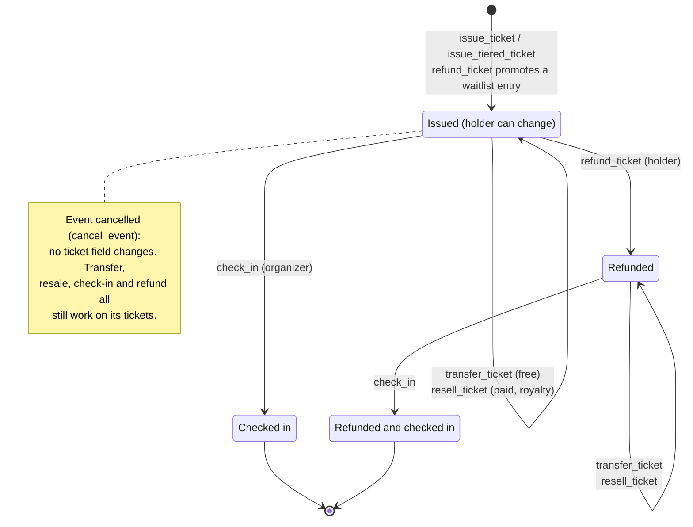

# Ticket transfers, refunds, and event cancellation

This page explains how the standalone `ticketing` contract changes who holds a ticket, what a refund does, and what cancelling an event does and does not do. It is for organizers running an event on the contract and for frontends that show ticket status. Every rule here comes from [`example/ticketing/src/lib.rs`](../../ticketing/src/lib.rs) and was checked by running the contract.

> **Warning:** The contract never moves money on a refund or a cancellation. Primary ticket sales take no payment on-chain (`issue_ticket` and `issue_tiered_ticket` are organizer mints), so there is nothing for the contract to return. A "refund" only marks the ticket as refunded. Paying the buyer back is the organizer's job, outside the contract.

This page covers the standalone contract only. For the former hub ticketing module and how the two compare, see [Choosing a ticketing model](choosing-a-ticketing-model.md).

## Ticket lifecycle

A ticket stores two one-way flags, `checked_in` and `refunded`, and a `holder` that can change. The event separately stores `state`, `Active` or `Cancelled`. Cancelling the event does not change any ticket field, so it is shown below as a condition, not a ticket state.



How the terms map onto the contract:

| Term | In the contract |
|---|---|
| Issued | A `Ticket` with `checked_in: false` and `refunded: false`, listed in the event's active tickets |
| Transferred | `holder` changed by `transfer_ticket`; no state change |
| Resold | `holder` changed by `resell_ticket`, with a payment; no state change |
| Checked in | `checked_in: true`, `check_in_time: Some(..)`. Final: a checked-in ticket cannot be refunded, transferred or resold. |
| Refunded | `refunded: true`, removed from the event's active tickets |
| Cancelled | `Event.state == EventState::Cancelled`. A property of the event, not the ticket. |

> **Warning:** `refunded` blocks only a second refund. A refunded ticket can still be transferred, resold and checked in, and `verify_ticket` still reports it as `valid: true`. Frontends and door staff must check `Ticket.refunded` and `Event.state` themselves; see [Showing ticket status](#showing-ticket-status).

## `transfer_ticket`

```rust
pub fn transfer_ticket(env: Env, current_holder: Address, ticket_id: u64, new_holder: Address)
```

Gives a ticket to another address with no payment.

**Authorization:** `current_holder` must sign, and must be the ticket's `holder`. Nobody else can move a ticket, including the organizer.

**Checks, in order:**

| Condition | Result |
|---|---|
| `ticket_id` does not exist | `TicketNotFound` (2) |
| `current_holder` is not the holder | `NotAuthorized` (3) |
| Ticket is checked in | `TicketAlreadyCheckedIn` (7) |

**Not checked:** whether the ticket is refunded, whether the event is cancelled or has ended, and whether `new_holder` equals `current_holder`. Transferring to yourself succeeds and emits an event.

**State change:** `Ticket.holder = new_holder`. Nothing else changes: not the QR hash, the tier or the check-in record. Whoever knows the QR hash can still present the ticket, so a frontend should issue a new QR code to the new holder off-chain.

**Event:** `TicketTransferedEvent` (spelled this way in the source). It has one topic, the symbol `ticket_transfered_event`, and its data is a map:

| Field | Type |
|---|---|
| `ticket_id` | `u64` |
| `event_id` | `u64` |
| `old_holder` | `Address` |
| `new_holder` | `Address` |
| `timestamp` | `u64`, ledger time of the transfer |

## `refund_ticket`

```rust
pub fn refund_ticket(env: Env, holder: Address, ticket_id: u64)
```

Retires a ticket and frees its seat for the waitlist.

**Authorization:** `holder` must sign and must be the ticket's current holder. The organizer cannot refund a ticket on a holder's behalf.

**Checks, in order:**

| Condition | Result |
|---|---|
| `ticket_id` does not exist | `TicketNotFound` (2) |
| `holder` is not the holder | `NotAuthorized` (3) |
| Ticket is checked in | `AlreadyCheckedIn` (6). Note this is a different code from `transfer_ticket`'s check-in error. |
| Ticket is already refunded | `TicketAlreadyRefunded` (19) |

### Eligibility window

There is none. `refund_ticket` checks no time and no event state, so a holder can refund at any point until the ticket is checked in: before the event, after `end_time`, and after the event is cancelled. A ticket that was transferred or resold after being refunded cannot be refunded again by its new holder (`TicketAlreadyRefunded`).

### Refund amount and funding source

The amount is **zero**, and there is no funding source. `refund_ticket` makes no token call. This applies to tiered tickets too: `Tier.price` is stored for display and is never charged or returned. If the buyer paid you, off-chain or through a Shade invoice, refund them through the same channel, and use `TicketRefundedEvent` as the trigger.

### Effect on supply counts

| Count | Effect |
|---|---|
| Event's active tickets (`get_event_tickets`, `get_event_ticket_count`) | Down by one. The refunded ticket is removed, which frees one seat of `max_capacity`. |
| `get_event_checked_in_count` | Unchanged, since a refunded ticket is not checked in |
| `Tier.sold` | **Unchanged.** The tier seat is not returned, so a refund in a tier that is sold out does not let you issue another ticket in that tier. |
| The `Ticket` record | Kept, with `refunded: true`. `get_ticket` still returns it. |

### Waitlist promotion

If the event's waitlist is not empty, the same call promotes the first entry:

1. The first `WaitlistEntry` is removed from the queue.
2. A new ticket is issued to that applicant. It has no tier (`tier_id: None`), even if the refunded ticket had one.
3. `TicketIssuedEvent` and `WaitlistAssignedEvent` are emitted.

The new ticket takes the seat the refund freed, so the active count ends where it started. Its QR hash is a placeholder: bytes 0–7 are the refunded ticket's ID and bytes 8–15 the ledger timestamp, both big-endian, and the rest are zero. The contract has no function to change a ticket's QR hash, and the placeholder is not checked against existing hashes. Map the promoted ticket to a real QR code off-chain.

Promotion happens even when the event is cancelled.

**Events:** `TicketRefundedEvent { ticket_id, event_id, holder, timestamp }`, then, if a waitlist entry was promoted, `TicketIssuedEvent` and `WaitlistAssignedEvent { event_id, assignee, ticket_id, timestamp }`.

## `cancel_event`

```rust
pub fn cancel_event(env: Env, organizer: Address, event_id: u64)
```

**Authorization:** `organizer` must sign and must be the event's organizer.

**Checks:**

| Condition | Result |
|---|---|
| `event_id` does not exist | `EventNotFound` (1) |
| `organizer` is not the event's organizer | `NotAuthorized` (3) |
| Event is already cancelled | `EventCancelled` (18) |

**State change:** `Event.state = EventState::Cancelled`, and `EventCancelledEvent { event_id, organizer, timestamp }` is emitted. Cancellation cannot be undone.

### What happens to issued tickets

Nothing. Every issued ticket keeps its holder, its flags and its place in the active list. Refunds are **neither automatic nor claimable with money**: the contract does not refund anyone, and there is no claim function. A holder can call `refund_ticket` to mark their ticket refunded, which still moves no tokens.

After cancellation:

| Operation | Still works? |
|---|---|
| `issue_ticket` | No: `EventCancelled` (18) |
| `issue_tiered_ticket` | **Yes.** It does not check the event state. |
| `transfer_ticket`, `resell_ticket` | Yes |
| `check_in` | Yes |
| `refund_ticket` | Yes |
| `join_waitlist` | Yes, if the event is at capacity |
| `add_tier`, `set_resale_config` | Yes |

### Effect on waitlists

The waitlist is not cleared. Applicants stay queued, new applicants can join while the event is full, and each `refund_ticket` still promotes the next applicant into a new ticket for the cancelled event. If you cancel an event, tell waitlisted applicants off-chain, and treat any ticket issued after `EventCancelledEvent` as void.

### Cancelling in practice

1. Call `cancel_event`.
2. Refund each buyer through the channel they paid with. `get_event_tickets` lists every active ticket and its holder.
3. Optionally, ask holders to call `refund_ticket` so that on-chain state shows the refund. It is not required, and only the holder can do it.
4. Stop issuing tiered tickets in your own tooling, since the contract will not stop you.

## Transfers compared with resales

Both change `Ticket.holder`. They differ in payment and in who has to sign.

| | `transfer_ticket` | `resell_ticket` |
|---|---|---|
| Signature | `current_holder.require_auth()` only. The receiver does not sign. | `seller.require_auth()` and `buyer.require_auth()` |
| Payment | None | `buyer` pays `sale_price` in `ResaleConfig.payment_token` |
| Organizer royalty | None | `sale_price × royalty_bps / 10_000` (rounded down) to the organizer; the rest to the seller |
| Requires `set_resale_config` | No | Yes, else `ResaleNotConfigured` (16) |
| Price check | Not applicable | `sale_price > 0`, else `InvalidResalePrice` (15) |
| Same address both sides | Allowed | Rejected with `SameHolder` (17) |
| Checked-in ticket | `TicketAlreadyCheckedIn` (7) | `TicketAlreadyCheckedIn` (7) |
| Refunded ticket or cancelled event | Allowed | Allowed |
| Events | `TicketTransferedEvent` | `TicketTransferedEvent`, then `TicketResoldEvent` with `sale_price`, `royalty`, `seller_proceeds` and `payment_token` |

Use `transfer_ticket` for gifts, moving a ticket between a user's own wallets, or a sale your marketplace settles off-chain. Use `resell_ticket` when the sale is paid on-chain and the organizer should receive a royalty.

> **Note:** A royalty is only collected when both parties use `resell_ticket`. A holder can always sell off-chain and move the ticket with `transfer_ticket`, which pays no royalty. The contract cannot prevent this.

`set_resale_config(organizer, event_id, payment_token, royalty_bps)` is organizer-only, rejects `royalty_bps` above 10,000 (`InvalidRoyaltyBps`, 14), and replaces any earlier configuration. Resales after the change use the new token and rate.

## Showing ticket status

Because the contract does not enforce every rule, derive a ticket's status from both `get_ticket` and `get_event`, in this order:

| Condition | Show |
|---|---|
| `refunded == true` | Refunded. Not valid for entry, whatever `verify_ticket` says. |
| `checked_in == true` | Used |
| `get_event(..).state == Cancelled` | Event cancelled. Not valid for entry. |
| Otherwise | Valid |

At the door, accept a ticket only if `verify_ticket` returns `valid: true` and `already_checked_in: false`, **and** `get_ticket` shows `refunded: false`, **and** the event is not cancelled. Only then call `check_in`.

## Related pages

- [Ticketing contract reference](../contracts/ticketing.md): every entry point, type, error and event.
- [Event waitlists](event-waitlists.md): joining and promotion in detail.
- [Ticket tiers](ticket-tiers.md): tier supply and pricing.
- [Choosing a ticketing model](choosing-a-ticketing-model.md): the standalone contract compared with the former hub module.
